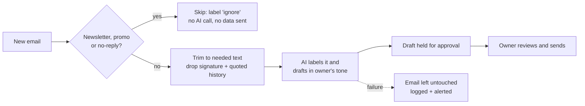

# AI Inbox Triage & Draft Assistant


**For a small business owner buried in email:** this reads each new message,
labels it **urgent / follow-up / FYI / ignore**, and writes a draft reply in the
owner's own tone. **It never sends anything.** Every draft waits for a person to
review it, edit it if needed, and click send.

It comes in two forms:

1. **Python app** (this repo): runs on your machine, exports to CSV / Google Sheets.
2. **Make.com scenario** ([`make/`](make/)): the same flow inside Gmail, ready to import.

> The sample inbox is fictional (a small home-care business). No real people or data.

---

## Try it in one command (no API key needed)

```bash
git clone https://github.com/CryptoGhost331/ai-inbox-triage-assistant.git
cd ai-inbox-triage-assistant
python -m triage
```

No installs. Python 3.10+ standard library only. Without an API key it runs in
**demo mode** (rule-based) so you can see the exact output shape.

### Sample output

```text
Run ede9eac2 | mode: DEMO (no API key, rule-based) | emails: 12

LABEL      STATUS             FROM                      SUBJECT
urgent     awaiting_approval  Priya Shah                Mum's visit tomorrow - can you send someone earl
urgent     action_needed      State Licensing Unit      ACTION REQUIRED: Staff background check renewal
urgent     awaiting_approval  Aaron Lee                 Running late - car won't start
follow-up  awaiting_approval  Northside Pharmacy        Medication delivery schedule change from 1 Novem
follow-up  awaiting_approval  Daniel Okafor             Enquiry about home care for my father
follow-up  awaiting_approval  Megan Torres              Re: Shift swap next week
follow-up  awaiting_approval  Tom Whitaker              Invoice question - October
fyi        no_reply_needed    Linda Park                Thank you
fyi        no_reply_needed    Community Care Network    Reminder: provider meetup on 6 November
ignore     skipped            CareSoft Weekly           5 rostering tips for the holiday season
ignore     skipped            no-reply@accounting-plat  Your invoice INV-2291 has been paid
ignore     skipped            Promo Deals               FLASH SALE: 40% off gloves and aprons - today on

6 draft(s) held for approval | 0 error(s) | 0 emails sent
```

A draft from the approval queue ([full file](sample_output/approval_queue.md)):

```text
Hi Tom,

Thanks for flagging this. Leave it with me: I'll check the visit records against
the invoice and come back to you by [CONFIRM DAY].

Thanks,
Jordan
```

Note the `[CONFIRM DAY]` placeholder: drafts never promise a time, price or
staff change the owner hasn't confirmed.

Every run writes:

| File | What it's for |
|---|---|
| `output/approval_queue.md` | The owner's review list: urgent items first, each draft with approve / edit / discard |
| `output/triage_results.csv` | One row per email. Opens directly in Google Sheets or Excel |
| `output/triage_results.json` | Same data for other tools |
| `output/logs/actions.jsonl` | A log line for every action taken on every email |
| `output/logs/alerts.log` | Anything that failed (only created if something did) |

---

## How it works



1. **Filter** (free, local): newsletters, promotions and no-reply senders are
   skipped before any AI call.
2. **Trim** (local): only the newest message text goes forward. Quoted history,
   signatures and phone footers are removed, capped at 2,000 characters.
3. **Label & draft**: one AI call returns structured JSON
   (`label`, `reason`, `summary`, `needs_reply`, `draft`), which is validated.
4. **Hold for approval**: drafts land in the approval queue. Nothing is sent.

### Tone

The draft voice comes from [`data/style_guide.md`](data/style_guide.md). In a
real project that guide is written from 20-50 of the owner's own sent emails,
and the owner reviews it before it's used.

---

## Safeguards

- **Human approval, enforced in code.** There is no send function in this
  project. A test (`test_no_send_capability_exists`) fails the build if one is added.
- **Least data out.** Bulk mail never reaches the AI. Everything else is trimmed first.
- **No silent failures.** A failed email is left untouched, logged, written to
  `alerts.log` and printed as an `ALERT`. The run continues with the next email
  and exits with a non-zero code so a scheduler can notice.
- **Retries with backoff.** Timeouts, rate limits (429) and server errors (5xx)
  retry with exponential backoff and jitter. Bad model output is *not* retried;
  it goes straight to the error path.
- **Dry-run switch.** `--dry-run` processes and prints but writes nothing.
- **Keys stay in environment variables**, never in files or logs.

---

## Live mode (Claude or OpenAI)

```bash
export ANTHROPIC_API_KEY=sk-ant-...     # or: export OPENAI_API_KEY=sk-...
python -m triage                         # auto-picks the provider with a key set
```

| Option | What it does |
|---|---|
| `--provider auto\|demo\|anthropic\|openai` | Choose the engine (default `auto`) |
| `--input PATH` | A JSON file, one `.eml` file, or a folder of `.eml` files exported from Gmail |
| `--style-guide PATH` | The owner's tone guide |
| `--out DIR` | Output folder (default `./output`) |
| `--dry-run` | Process and print only; write no files or logs |
| `--retries N` | Attempts per email on transient errors (default 4) |

Models can be changed with `ANTHROPIC_MODEL` or `OPENAI_MODEL`.

---

## Make.com version

[`make/ai_inbox_triage_blueprint.json`](make/ai_inbox_triage_blueprint.json) is
an importable Make scenario of the same flow:

**Gmail: Watch emails** (inbox, promotions and no-reply excluded) →
**Gmail: Get an email** → **Claude: Create a prompt** (style guide + trimmed
email, JSON back) → **Parse JSON** → *filter: needs a reply* →
**Gmail: Create a draft** (in the same thread).

- The Claude step has a **Break** error handler: 3 automatic retries, then the
  run is stored as an incomplete execution and Make emails an alert.
- The scenario only ever **creates drafts**. It has no send module.

Setup steps are in [`make/README.md`](make/README.md).

---

## Tests

```bash
python -m unittest discover -s tests -v
```

28 tests cover filtering, trimming, labelling, whole-word keyword matching,
JSON validation, the Claude and OpenAI request format (HTTP stubbed), retry/backoff, the error path, exports and the no-send rule.
They run on every push via GitHub Actions.

## Project layout

```
triage/
  cli.py         command line (python -m triage)
  pipeline.py    filter -> trim -> label & draft -> hold, with error path
  filters.py     bulk-mail detection and text trimming
  providers.py   demo rules, Claude and OpenAI (stdlib HTTP, JSON output)
  retry.py       exponential backoff with jitter
  actionlog.py   JSON Lines action log + alerts
  export.py      CSV, JSON and the approval queue
  loader.py      JSON or .eml input
data/            sample inbox and tone guide
make/            Make.com blueprint + setup notes
sample_output/   output from the demo run shown above
tests/           unittest suite
```

---

## About

Built by **Kyle L.**, who builds and fixes automations (Make, n8n, Zapier,
Python, APIs) for small businesses. Built with AI-assisted development, then
reviewed, tested and run by me. The retry, logging and hard-stop patterns come
from my own trading-bot work on the Kraken API.

MIT licensed.
